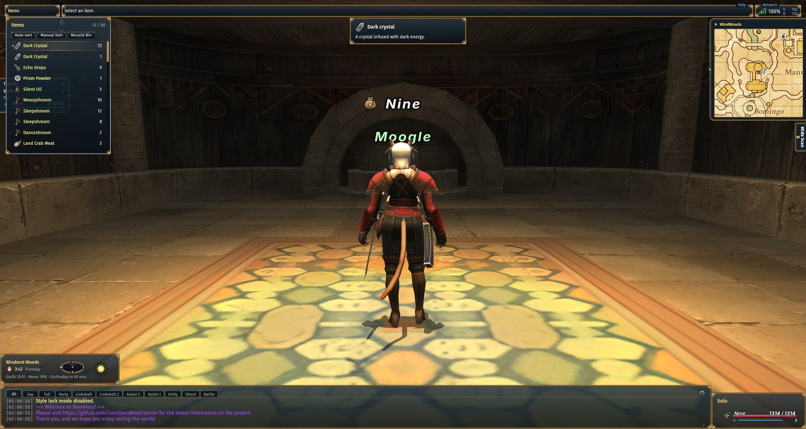
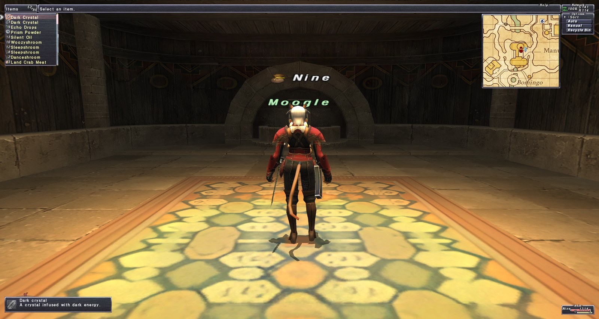
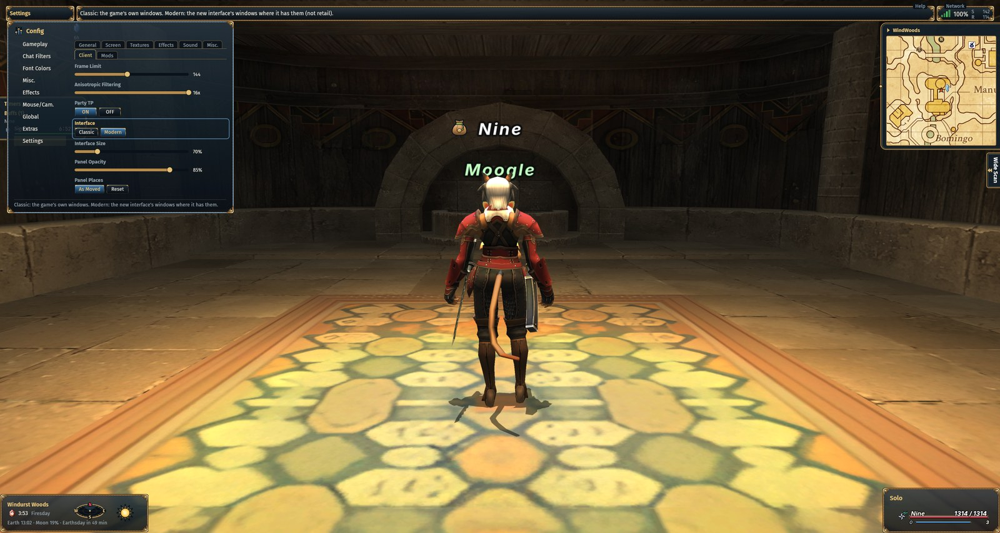
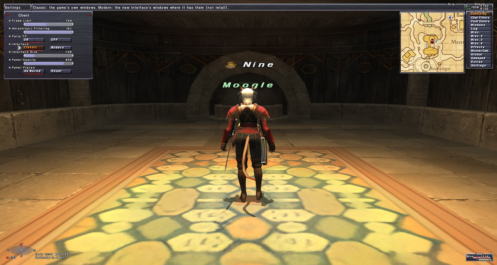

<p align="center"></p>

<p align="center"><a href="https://ko-fi.com/K3K51TO6S1"></a></p>

# vana-client

A native client for FINAL FANTASY XI, written in Rust, for [LandSandBoat](https://github.com/LandSandBoat/server)
(LSB) servers. It runs without Wine and without PlayOnline: it reads the game's data files and talks to the
server directly.

The goal is a faithful clone of the retail client first. Its menus, sprites, fonts, motions and cameras are rebuilt
from the game's files and from the behaviour of the original executable. Improvements come after that.
Retail limits that only existed because of 2002 hardware, like the 30 fps cap, become settings.

It runs on Linux and Windows (64-bit); builds of both are on the [releases page](https://github.com/lenonk/vana-client/releases).
macOS is planned.

## Two interfaces

The client has two interfaces, switched at any time in Config > Settings > Client > Interface:

- **Classic**: the retail client's windows, drawn from the game's menu files as the original draws them.
- **Modern**: a new interface over the same game rules: movable windows, a command menu, mouse support everywhere,
  tooltips, a minimap, a chat window with tabs, and one consistent set of controls and keys (see
  [docs/modern-ui.md](docs/modern-ui.md)).

| Modern | Classic |
|---|---|
|  |  |
|  |  |

## Status

Playable on a local LSB server. Working today:

- Login, the lobby, character creation (with the original creator scenes), character select and the new-character
  openings
- Zones with GPU skinning, compressed textures with mipmaps, lighting, sky, fog and weather
- Players, NPCs and monsters with their motions, collision (characters, doors, lifts) and name plates with their
  icons (GM, bazaar, New Adventurer, mentor, linkshell and the rest)
- NPC dialogue, event scripts and cutscenes
- Effects: spells, abilities, weapon skills and skillchains, damage numbers, footsteps, level up and the other
  milestone effects
- The retail key set: numpad movement, autorun, first person, F-key targeting, macros and palettes
- Gamepads (see [Gamepad](#gamepad))
- The HUD, chat log and chat line (chat modes, auto-translate, text commands), targeting, combat, and the magic,
  ability and mount menus
- The main menu: Status (merit points, job points, currencies, Unity), Equipment and equipment sets, Items and
  storage, the map, Party and Level Sync, Linkshell, Search, Missions, Quests, Key Items, Region Info, Bazaar, the
  Help Desk and the macro editor
- Trading, NPC and guild shops, the Delivery Box and the treasure pool
- Alter Ego Points, automaton customization, blue magic sets, mounts, the Friend List and PlayOnline messages
- Fishing, chocobo racing, Monstrosity, Mog House layout, gardening and mannequins
- The in-game and lobby Config menus, with an Extras page for additions such as a map overlay, a minimap, timers, a
  skillchain helper and chat timestamps
- Game updates from the PlayOnline patch server, an Update button for the client itself, and a mod manager for HD
  texture packs (install from an archive, order, enable, uninstall). Our HD pack, the game's textures upscaled 4x, is
  on the [releases page](https://github.com/lenonk/vana-client/releases/tag/hd-pack-1)
- Music and sound effects
- Lua mods: commands, windows and HUD elements in the game's look, drawing in the world, chat filters, and game
  actions with the player's permission. See [writing mods](docs/modding/README.md)

Not done yet:

- Some event script operations (the mini-games on 0xb3 among them)
- macOS builds

## Requirements

- A GPU with Vulkan support
- Rust 1.85 or newer (edition 2024)
- PipeWire or PulseAudio for sound
- The game data from Square Enix's official installer, `FFXIFullSetup_US.part1.exe` and its other parts
- A LandSandBoat server to connect to

No game data is included in this repository.

## Build

```sh
cargo build --release
```

On Linux the build needs PipeWire's headers (`libpipewire-0.3-dev`). Where they are too old for cpal's PipeWire bindings (Ubuntu 22.04 fails, 24.04 builds), `cargo build --release --no-default-features` leaves PipeWire output out; sound then goes through PulseAudio (or PipeWire's PulseAudio server) or ALSA.

The binary is `target/release/vana-client`. Release builds are incremental, without link-time optimisation; for a binary to hand out, `cargo build --profile dist` (fat LTO, one codegen unit) writes `target/dist/vana-client`.

Published releases are built with `release/build-linux.sh` (in the Steam Runtime 3 "sniper" SDK container, so one binary runs on every current distro) and `release/build-windows.sh` (a MinGW cross build), then `release/publish.sh VERSION` tags them, signs each with the release key (Ed25519, kept outside the repo; its public half is `release/signing-key.pub`, built into the client) and creates the GitHub release that the in-app Update offers. The client installs a release only when its signature checks.

## Install the game data

Point the installer command at the first part of the official setup, or at an extracted copy of it:

```sh
target/release/vana-client install /path/to/FFXIFullSetup_US.part1.exe
```

This unpacks the game to `~/.local/share/vana-client/game/FINAL FANTASY XI` with the same layout the Windows
installer uses. Use `--game-dir` to put it somewhere else. An existing Windows install can also be copied there,
or pointed at with `game_dir` in the config (see below). Started without game files, the client offers to download
them, or to use an install already on disk with "Use existing game files...".

The installer's data is years old. To bring it up to the current retail version from the PlayOnline patch server:

```sh
target/release/vana-client update
```

## Play

```sh
target/release/vana-client play
```

You log in on the game's login screen. The server address and ports come from the config file.

On Linux the client installs itself the first time it starts: it copies itself to
`~/.local/share/vana-client/vana-client` and adds an application menu entry and its icon that start that copy.
In-app updates replace the copy you run. Wayland compositors find the window's icon through this entry.

To create an account on the server from the command line:

```sh
target/release/vana-client account-create --credentials account.json --user NAME
```

This writes the username and a generated password to `account.json`.

## Configuration

Settings are in `~/.config/vana-client/config.json`. The file is created on first save, and most options can be
changed from the in-game Config menus. The fields you may need to set by hand:

| Field | Default | Meaning |
|---|---|---|
| `server` | `127.0.0.1` | LSB server address |
| `auth_port`, `data_port`, `view_port` | `54231`, `54230`, `54001` | LSB login and lobby ports |
| `game_dir` | `~/.local/share/vana-client/game` | Folder that holds `FINAL FANTASY XI` |
| `client_version` | `30261006_0` | Version sent to the lobby; must be at least the server's `CLIENT_VER` |
| `frame_limit` | `300` | Frame limit in fps, `0` for unlimited |
| `gpu` | empty | Graphics adapter by name; empty picks the high-performance one |
| `audio_device` | empty | Output device; empty uses the system default |
| `gamepad`, `gamepad_padsin` ... | | See [Gamepad](#gamepad) |

### Gamepad

Controllers work through the game's own pad path: the buttons set the pad bits the game's key functions test, and
the sticks fill its stick bytes. Settings > Client turns the pad on or off and sets the sticks' dead zone. The button
settings use the format of the registry value `padsin000` that FFXiPadConfig.exe writes, so a setting can be copied
over as is; the default is FFXiPadConfig's XInput layout:

| Button | Does |
|---|---|
| A / Cross | Confirm, the action menu |
| B / Circle | Cancel |
| X / Square | Main menu |
| Y / Triangle | Active window |
| D-pad | In a menu: the cursor. In the field and in a target prompt: up / down the party and alliance members, left / right the actors on screen (no actor that way: yourself) |
| Left stick / right stick | Move / camera (the camera's invert rows in Mouse/Cam. apply to the stick) |
| LB / L1 | Autorun; in a window with tabs (modern), the previous tab |
| RB / R1 | The software keyboard (with Config > Misc. 4 > Software Keyboard on); with the windows hidden, a screenshot; in a window with tabs (modern), the next tab |
| LT / L2, RT / R2 | In the field: open or close the Ctrl / Alt macro palette (the other trigger swaps; held, it opens on its own); in it the d-pad picks the macro and the set, A runs it, B closes. In a window: held, the d-pad pages lists; both held, left / right switch the item bag. In a Geo- spell's target prompt: held, the d-pad moves the spot it lands on |
| L3 | Rest, or lock on with a target; on the map, back to where you were when it opened |
| R3 | First / third person |
| Back / Select | Hide or show the windows |
| Start | Log out |

Typing on the pad: turn on Config > Misc. 4 > Software Keyboard, then RB brings up the game's software keyboard over
the text field (or opens the chat line with it). The d-pad moves its cursor, A types the key, B is Escape, LB
Backspace, RB a space, X switches to capitals and symbols, Y is Enter, LT / RT move the caret, Start is Tab and Back
closes it. Any key on a real keyboard closes it too. The modern UI draws it as one of its own panels.

| Field | Default | Meaning |
|---|---|---|
| `gamepad` | `true` | Read a game controller (Settings > Client > Gamepad) |
| `gamepad_deadzone` | `0.33` | Stick travel ignored around the centre, measured round so turning the stick does not snap to its axes (Settings > Client > Stick Dead Zone) |
| `gamepad_background` | `false` | Read the pad while the window is in the background |
| `gamepad_padsin` | empty (FFXiPadConfig's XInput default) | Button settings in `padsin000` format: 32 numbers, one per function, each an XInput button number (0 B, 1 X, 2 Y, 3 A, 4 / 5 / 6 / 7 d-pad right / left / up / down, 8 LB, 9 LT, 10 L3, 11 RB, 12 RT, 13 R3, 14 Start, 15 Back), an axis 32 + n (1 left X, 2 left Y, 4 right X, 5 right Y; negative inverts) or -1. The positions are listed in MODLOG.md, "Gamepad" |
| `gamepad_padexsin` | empty | `padexsin000`, the buttons used while the "alternate map" button is held |

Building on Linux needs libudev's headers (`libudev-dev`, `systemd-devel`); the binary needs `libudev.so.1`, which
every systemd distro and the Steam Runtime have.


### Server certificates

The login and Friend List connections use TLS. A certificate signed by a public authority (Let's Encrypt, for one) is
checked as a browser checks it, and renewals just work. A self-signed one (what LSB makes by default) can't be checked
that way, so the client remembers the key each server's certificate has the first time (`known_servers.json` in the
data folder: `~/.local/share/vana-client` on Linux, `%APPDATA%\vana-client` on Windows) and refuses a different one
later, since that is what someone intercepting the connection would send. When a server really gets a new key (an LSB
reinstall makes one), trust it with:

```sh
vana-client trust-server SERVER            # forget SERVER's pins (every port); the next login pins the new keys
vana-client trust-server SERVER --port 54231 --fingerprint AB:CD:...   # or pin a known key up front
```

On the server, `openssl x509 -in login.cert -noout -pubkey | openssl pkey -pubin -outform DER | openssl dgst -sha256`
prints the login port's key fingerprint (`profile.cert` is the Friend List's, ports 51220 and 51240).

## For developers

- `MODLOG.md` records every reverse-engineered fact the code relies on: addresses in the original executable,
  DAT formats, packets. Anything inferred rather than read from the binary is marked as inferred. Read the
  relevant section before changing behaviour, and add what you learn.
- `cargo test --release` runs the tests. Tests that need the game data skip themselves when it isn't installed.
- Offscreen tools render parts of the client to PNG without opening a window, for example `zone-shot`, `npc-shot`,
  `char-shot`, `select-shot`, `creator-shot` and `cs-shot`. Others decode game files: `dat-info`, `ui-dump`,
  `event-dump`, `msg-dump`. Run `vana-client --help` for the full list.
- `play --input '<script>'` drives the client from a script for test runs (see `client/script.rs`).

## Disclaimer

This is an unofficial fan project. It is not affiliated with, endorsed by or supported by Square Enix.
FINAL FANTASY is a registered trademark of Square Enix Holdings Co., Ltd. The repository contains no game data and
no code from the original client. To use it you need the game files from Square Enix's installer.

## License

vana-client is released under the [MIT License](LICENSE).

Bundled third-party files keep their own licenses: the Fira Sans, Inter and JetBrains Mono fonts are under the SIL
Open Font License (the texts are beside them in `crates/vana-client/assets/fonts`), and the patched copy of
gpu-allocator in `vendor/gpu-allocator` is under MIT or Apache-2.0. The game's files are Square Enix's and are not
covered by this license.
